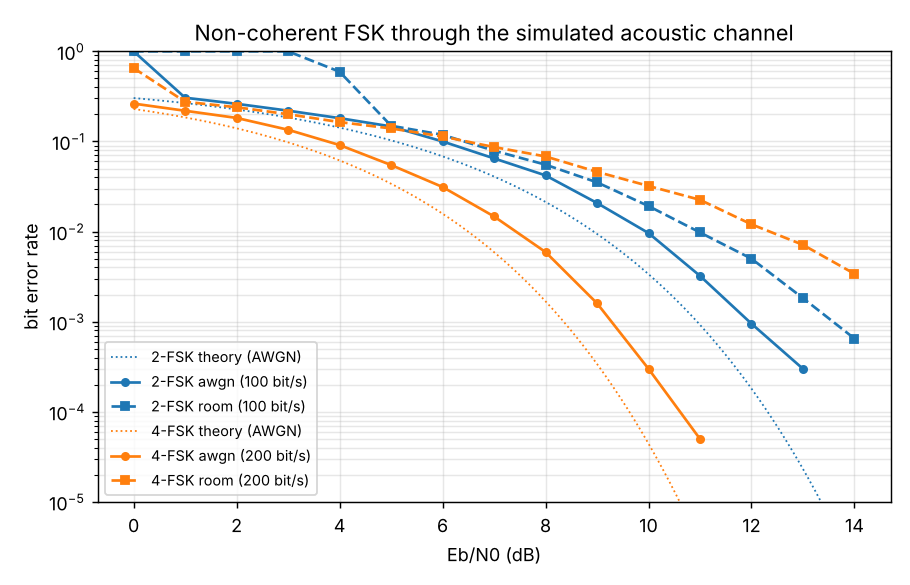

# sonic-modem

A hands-on lab on digital communication over sound: data is modulated into
audio, played through a speaker, captured by a microphone, and demodulated back
into bits. The lab covers ASK, FSK, PSK and QAM and compares their bit error
rate and data rate over a real acoustic channel.

There is no audio hardware in the loop yet, so everything currently runs
through a **simulated acoustic channel**. The real speaker/microphone path
plugs in behind the same interface later.

## Quick start

```bash
pip install -e '.[dev]'
pytest
python scripts/ber_vs_snr.py          # writes results/ber_fsk.{csv,png}
```

```python
from sonic_modem import AcousticChannelConfig, FSKModem, Link, SimulatedAcousticChannel
from sonic_modem.bits import bits_to_bytes, bytes_to_bits

link = Link(FSKModem(M=4))                                     # 200 bit/s
room = SimulatedAcousticChannel(AcousticChannelConfig(snr_db=-5), seed=0)
res = link.send(room, bytes_to_bits(b"hello, acoustic world"))
print(bits_to_bytes(res.bits))                                 # b'hello, acoustic world'
```

## Layout

| Module | Role |
|---|---|
| `sonic_modem/modems/base.py` | `Modem` interface: `modulate(bits)` / `demodulate(samples, n_bits)`. ASK, PSK and QAM go next to FSK here. |
| `sonic_modem/modems/fsk.py` | Continuous-phase M-FSK, Gray-coded, non-coherent (energy) detection with an echo guard interval. |
| `sonic_modem/sync.py` | Linear chirp preamble and matched-filter detector (CFAR threshold, picks the direct path, not the strongest echo). Shared by every modem. |
| `sonic_modem/link.py` | Frame = preamble + gap + data. `Link(modem).send(channel, bits)` runs the whole chain. |
| `sonic_modem/channels/base.py` | `Channel` interface: `transmit(samples) -> recording`. |
| `sonic_modem/channels/simulated.py` | Speaker band-pass, room echoes, attenuation, mic band-pass, fractional delay and clock drift, random start delay, AWGN. Each stage is configurable or can be turned off. |
| `sonic_modem/channels/audio.py` | `SoundDeviceChannel` for a real speaker and mic (`pip install '.[audio]'`). Written against the same interface but not yet tested on hardware. |
| `sonic_modem/metrics.py` | BER counting, SNR to Eb/N0 conversion, non-coherent M-FSK theory. |
| `scripts/ber_vs_snr.py` | BER vs Eb/N0 sweep through the full receive chain. |

### SNR convention

`snr_db` in the simulator is received signal power over noise power across the
whole band 0..fs/2. Because the modem only occupies a few hundred Hz of a
24 kHz band, useful operating points sit at negative SNR. Plots use Eb/N0,
where `Eb/N0 = SNR + 10*log10(fs / (2*bit_rate))` (23.8 dB at 48 kHz and
100 bit/s), so they can be compared to textbook curves.

## First results: FSK



Defaults: 48 kHz, 100 baud, tones centred at 2.5 kHz, 20 % guard interval,
200 ms chirp preamble, 1000-bit frames. "room" is the default
`AcousticChannelConfig` (speaker 300 Hz to 8 kHz, mic 100 Hz to 12 kHz, echoes
at 3/9/21 ms, 20 dB loss) plus 30 ppm clock offset.

* **AWGN:** measured curves track theory about 1 to 1.5 dB to the right.
  About 1 dB is the guard interval, which throws away 20 % of every symbol's
  energy.
* **Room:** echoes, not band-limiting, are what hurt. Turning off the filters
  changes nothing, while removing the echoes brings 4-FSK at 12 dB Eb/N0 from
  1.5e-2 to zero errors. The 3 ms echo makes the response a comb with notches
  every 333 Hz, so some tones arrive several dB weaker than others; the 9 and
  21 ms echoes also spill past the 2 ms guard into the next symbol.
  A 40 % guard (which also widens the default tone spacing to 333 Hz, in step
  with that comb) removes the errors in this particular room, at the cost of
  2.2 dB. Placing tones to avoid the room's notches is worth exploring once
  there is a real room to measure.
* **Sync:** the preamble is found down to about 1 dB Eb/N0 in AWGN and 5 dB in
  the room. Below that whole frames are lost (BER 1 on the plot).
